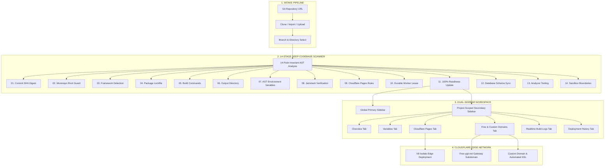

# YGIT Deployment Platform (ygit.net) UI Design System

<div align="center">


### **Next-Generation Git-to-Edge Jamstack Deployment Engine**
#### *Designed & Architected Exclusively for **[ygit.net](https://ygit.net)***

[](https://ygit.net)
[](https://ygit.net)
[](https://ygit.net)
[](https://ygit.net)
[](https://ygit.net)
[](https://www.typescriptlang.org/)
[](https://vitejs.dev/)
[](https://react.dev/)

**All Product, System, and Architectural Credits Belong to [YGIT Platform](https://ygit.net) (`ygit.net`)**

</div>

---

## ⚡ Executive Overview

**YGIT Platform UI (`ygit.net`)** is an enterprise-grade, high-density edge deployment dashboard built for developers deploying Jamstack websites, static generators, modern frameworks (Next.js, Vite, React, Astro, Remix, Nuxt, SvelteKit), and Cloudflare Pages & Workers microservices with zero configuration friction.

Following strict **Vercel, Linear, and Cloudflare Dashboard design standards**, this interface adheres to a **Zero-Radius (`--radius: 0rem`)**, **Zero-Shadow**, and **Component-Only Architecture**. Every button, input, card, badge, and table is fed from universal design tokens supporting both **Crisp Light** and **Deep Dark** modes.

---

## 🎨 UI & Design Constitution

```
┌────────────────────────────────────────────────────────────────────────┐
│                      YGIT DESIGN SPECIFICATION                         │
├──────────────────────┬─────────────────────────────────────────────────┤
│ Font Engine          │ "Segoe UI", "Segoe UI Web", system-ui,          │
│                      │ -apple-system, "Helvetica Neue", sans-serif     │
│ Code Font Engine     │ 'JetBrains Mono', ui-monospace, Consolas        │
│ Corner Radii         │ 0rem (rounded-none across all components)       │
│ Box Shadows          │ None (0px flat architectural boundaries)        │
│ Design Hierarchy     │ Component-Only Single Source of Truth           │
│ Theme Engine         │ Dual Dynamic: Dark & Light                      │
│ Primary Accent       │ #1d6cf6 (Dark) / #0969da (Light)                │
│ Secondary Accent     │ #238636 (Dark) / #1a7f37 (Light)                │
│ Border Specification │ 1px Subtle Boundary (rgba(255,255,255,0.1)/#d8) │
└──────────────────────┴─────────────────────────────────────────────────┘
```

---

## 🏗️ Architectural Flow & State Lifecycle Diagram

The YGIT UI orchestrates a complete lifecycle from repository intake to live edge distribution:



---

## 📂 Detailed Project Structure

```
ygit-deployment-platform/
├── public/                                  # Static Assets & Screenshots
│   └── assets/aistudio/                     # Curated Visual Artifacts
├── src/
│   ├── components/                          # Universal UI Primitives (Single Source of Truth)
│   │   ├── badges/
│   │   │   ├── FrameworkBadge.tsx           # Monospace framework chip with theme tokens
│   │   │   ├── MetricPill.tsx               # Monospace numeric/status badge
│   │   │   └── StatusBadge.tsx              # Live, passed, building, verified, failed pills
│   │   ├── brand/
│   │   │   ├── BetaPill.tsx                 # Official micro beta brand badge
│   │   │   └── YGitLogo.tsx                 # SVG Brand mark & platform title
│   │   ├── buttons/
│   │   │   ├── Button.tsx                   # Universal button (7 archetypes, 0rem radius)
│   │   │   ├── IconButton.tsx               # Tactile icon actions with theme variables
│   │   │   ├── PrimaryButton.tsx            # Main brand action trigger
│   │   │   ├── SecondaryButton.tsx          # Neutral slate secondary button
│   │   │   └── buttons.test.ts              # Architectural invariant unit tests
│   │   ├── cards/
│   │   │   ├── Card.tsx                     # Zero-shadow card, header, body, footer, enclave
│   │   │   └── cards.test.ts                # Card variant style invariant unit tests
│   │   ├── errors/
│   │   │   └── AppErrorBoundary.tsx         # Global render exception handler with 1-click reload
│   │   ├── modals/                          # Modal shells & specialized dialogs
│   │   │   ├── AccountsModal.tsx            # GitHub & Cloudflare provider credentials
│   │   │   ├── CloudflareBindingsModals.tsx # KV, D1, R2, and Webhook binding builders
│   │   │   ├── CreateProjectModal.tsx       # 3-tab repository intake dialog
│   │   │   ├── DeleteProjectModal.tsx       # Protected irreversible project deletion modal
│   │   │   ├── DnsConfigModal.tsx           # Automated CNAME / Apex DNS verification modal
│   │   │   ├── EditCustomDomainModal.tsx    # Domain routing & branch redirect modal
│   │   │   ├── EditEnvModal.tsx             # Environment variable modification modal
│   │   │   ├── ModalShell.tsx               # Universal accessible backdrop & container
│   │   │   ├── PasteEnvModal.tsx            # Multi-line .env bulk ingestion dialog
│   │   │   ├── PurgeCacheModal.tsx          # Instant Cloudflare edge CDN cache purge dialog
│   │   │   └── TemplateModal.tsx            # 4-tab starter template inspection & deployer
│   │   ├── navigation/
│   │   │   ├── PrimarySidebar.tsx           # Global brand, routes, accounts, status pill
│   │   │   └── SecondarySidebar.tsx         # Project-scoped context switcher & tabs
│   │   ├── templates/
│   │   │   └── TemplateThumbnailGraphic.tsx # Browser-framed live preview canvas & vector fallback
│   │   └── ui/                              # Consolidated Barrel Exports
│   │       ├── Badge.tsx                    # Shared badge primitive
│   │       ├── Button.tsx                   # Shared button primitive
│   │       ├── Card.tsx                     # Shared card primitive
│   │       ├── Input.tsx                    # Accessible input with prefix/suffix icons
│   │       ├── Modal.tsx                    # Shared modal primitive
│   │       ├── Select.tsx                   # Monospace & standard select primitive
│   │       ├── Table.tsx                    # High-density data ledger suite
│   │       └── index.ts                     # Single barrel entry point
│   ├── features/                            # Domain-Driven Feature Views
│   │   ├── accounts/
│   │   │   └── AccountsView.tsx             # OAuth providers, tokens, permission scopes
│   │   ├── dashboard/
│   │   │   └── DashboardView.tsx            # 6-metric telemetry strip, rapid intake pipeline
│   │   ├── deployments/
│   │   │   └── DeploymentsView.tsx          # Chronological deployment ledger with filters
│   │   ├── projects/
│   │   │   └── ProjectsView.tsx             # Multi-project catalog, search & provider filters
│   │   ├── scanner/
│   │   │   ├── IntakePipeline.tsx           # 4-channel intake pipeline (GitHub, GitLab, Zip, Git)
│   │   │   └── ScanConsole.tsx              # 14-checkpoint live inspector, AST digest, raw spec
│   │   ├── settings/
│   │   │   └── SettingsView.tsx             # 4-tab settings: Profile, Notifications, Security, Theme
│   │   ├── templates/
│   │   │   └── TemplatesView.tsx            # Ready production starter gallery (Wix/Shopify store)
│   │   └── workspace/
│   │       ├── WorkspaceView.tsx            # Top breadcrumb bar, project actions, tab router
│   │       └── tabs/
│   │           ├── CloudflareTab.tsx        # 8 sub-sections (Build, Functions, Speed, Security...)
│   │           ├── DomainsTab.tsx           # Free subdomain engine (*.ygit.net) & Custom DNS
│   │           ├── HistoryTab.tsx           # Full deployment audit table & rollbacks
│   │           ├── LogsTab.tsx              # Streaming edge terminal viewer with search
│   │           ├── OverviewTab.tsx          # 6 deep intelligence cards & 14 invariant matrix
│   │           └── VariablesTab.tsx         # Encrypted secrets table with decrypt toggle
│   ├── layouts/
│   │   └── DualSidebarLayout.tsx            # High-density twin-sidebar responsive grid
│   ├── mocks/                               # Deterministic Seed Data
│   │   ├── mockDeployments.ts               # Sample deployment records with timings
│   │   ├── mockEnvVars.ts                   # Realistic production and preview secrets
│   │   ├── mockProjects.ts                  # Multi-framework test projects (Vite, Next, Astro)
│   │   ├── mockScanCheckpoints.ts           # 14 invariant scanner checklist state
│   │   ├── mockSettings.ts                  # Platform user preferences
│   │   └── mockTemplates.ts                 # 8 production starter templates with live routes
│   ├── types/                               # TypeScript Definitions
│   │   ├── common.ts                        # ActiveRoute, WorkspaceTab, Providers
│   │   ├── deployment.ts                    # DeploymentRecord & step statuses
│   │   ├── project.ts                       # Project & Framework specification
│   │   ├── scanner.ts                       # ScanResult, Invariants, Checkpoint items
│   │   ├── settings.ts                      # User settings & security models
│   │   └── template.ts                      # ReadyTemplate, live routes, lighthouse audit
│   ├── App.tsx                              # Root SPA routing, theme switch engine, toasts
│   ├── index.css                            # Tailwind v4 @theme tokens, Segoe UI font engine
│   └── main.tsx                             # React 19 root bootstrap
├── notes/                                   # Audit Documentation & Phase Logs
│   ├── 000_baseline_freeze.md               # Baseline file inventory & freeze declaration
│   ├── 001_forensic_audit_report.md         # Comprehensive forensic audit findings & proofs
│   ├── 002_update_roadmap.md                # 6-phase scope-locked implementation roadmap
│   ├── 003_phase_execution_logs.md          # Real-time phase tracker & completion audit
│   ├── 004_error_handling_architecture.md   # Error recovery & boundary architecture
│   └── 005_feature_parity_matrix.md         # Feature verification matrix (100% parity)
├── AGENTS.md                                # Mandatory YGIT UI Architecture Guidelines
├── package.json                             # Dependencies & Scripts
├── tsconfig.json                            # Strict TypeScript configuration
└── vite.config.ts                           # Vite configuration with Tailwind CSS v4
```

---

## 🌟 Pages & Feature Suite

### 1. Global Navigation & Dual-Sidebar Layout
- **Brand Lockup**: High-density YGIT SVG logo with micro `beta` badge.
- **Top Utility Header**: Universal search input (`Ctrl + K`), dynamic **Light/Dark theme toggle button**, primary action `+ New Project`, and user profile selector (`@vibtools`).
- **Collapsible Global Sidebar**: Instant toggling between expanded (190px) and compact icon-only (54px) navigation.
- **Project-Scoped Secondary Sidebar**: Dedicated sub-navigation for active projects across 6 dedicated views (`Overview`, `Variables`, `Cloudflare`, `Domains`, `Logs`, `History`).

### 2. Dashboard View (`/dashboard`)
- **6-Metric Realtime Telemetry Strip**: Instant calculations for `Total Projects`, `Deployments`, `Success Rate (100%)`, `Active Providers (2/2)`, `Platform Status (Operational)`, and `Queue Status (Idle)`.
- **Rapid Pipeline Intake**: 4-step progress trigger (`1. Paste` → `2. Analyze` → `3. Connect` → `4. Deploy`) with instant URL dispatch.
- **Connected Provider Micro-Cards**: Realtime statuses for GitHub and Cloudflare Global Edge POPs.
- **Live Path Execution Terminal**: Step-by-step progress timer with direct edge gateway URL copy affordance.

### 3. Projects Catalog View (`/projects`)
- **Multi-Provider Filtering**: Filter by `All Providers`, `GitHub`, or `Cloudflare`.
- **Dynamic Search**: Instant client-side filtering across repository names and edge domains.
- **Project Cards**: Displays project name, repository source, edge domain (`*.pages.dev`), last updated timestamp, and live status badge.

### 4. Deployments Ledger View (`/deployments`)
- **Ledger Controls**: Status filter (`All`, `Live`, `Passed`, `Building`, `Failed`), search by commit SHA or message.
- **Deployment Table**: Columns for `Commit SHA & Message`, `Branch`, `Target Environment`, `Duration`, `Deployed Timestamp`, and `Actions (Rollback / Inspect)`.

### 5. Connected Accounts View (`/accounts`)
- **GitHub Provider Enclave**: Connected user handle, OAuth scope confirmation (`repo`, `workflow`, `read:org`), and re-authenticate trigger.
- **Cloudflare Edge Enclave**: API Token status, Account ID mask, and Zone permissions.

### 6. Templates Gallery View (`/templates`)
- **8 Production Starters**: E-Commerce (ShopFlow Pro), SaaS (Nexus SaaS Enterprise), AI Tooling (Synapse AI Studio), Portfolio (Minimalist DevPortfolio), Blog (EdgeMark CMS), Agency (Vanguard Agency), Docs (DocuEdge Engine), and API Server (HyperEdge Hono API).
- **Lighthouse Performance Metrics**: 100/100 verification scores for Performance, Accessibility, Best Practices, and SEO.
- **Live Routes Explorer**: Dynamic inspection of all application routes and rendering strategies (`Edge SSR`, `Static SSG`, `Dynamic API`).
- **1-Click Clone & Deploy**: Clones starter repo directly into user workspace with pre-populated environment variables.

### 7. Deep Codebase Scanner (`14 Invariant Checkpoints`)
Whenever an intake pipeline processes a repository, it executes 14 deterministic inspection gates:
1. **Commit Evidence**: Commit-pinned AST analysis with deterministic SHA digest (`sha256:e3b0c44`).
2. **Root Detection**: Monorepo detection with root selection (`/` vs `apps/web`) and fail-closed blocker safeguards.
3. **Framework Detection**: Vite, React, Vue, Astro, Hugo, Jekyll, Docusaurus, Static HTML.
4. **Package Manager & Lockfile**: `pnpm`, `npm`, `yarn`, `bun` with zero-conflict validation.
5. **Command Resolution**: Package script inspection resolving install & build commands (`pnpm run build`).
6. **Output Directory**: Target `dist`, `build`, `public`, `_site`, and Wrangler output paths.
7. **Environment Variables**: AST variable reference detector (`VITE_*`, `CF_*`) with zero secret leakage.
8. **Runtime Detection**: Static Jamstack execution verification.
9. **Cloudflare Pages Compatibility**: Framework registry validator & `wrangler.toml` schema validation.
10. **Durable Worker Lifecycle**: Job queue allocation, worker lease, and retry engine registration.
11. **Project Readiness**: Context attachment to project metadata and readiness state update (`100% READY`).
12. **Database Migration**: `0013_repository_analysis_deep_architecture` metadata sync & Alembic width fix.
13. **Analyzer Tooling**: Go `go-enry` helper, Node helper, Tree-sitter, Python analyzer, and Docker integration.
14. **Security Boundaries**: Provider execution disabled, zero code execution, zero secret persistence, isolated workers.

### 8. Project Workspace View (`6 Specialized Tabs`)
- **`Overview`**: 6 deep intelligence cards, metadata summary, and 14 invariant checkpoints matrix.
- **`Variables`**: Environment variables ledger, encrypted secret toggle (`••••••••`), target selection (`Production`, `Preview`, `Development`), and bulk `.env` paste.
- **`Cloudflare`**: 8 comprehensive sub-sections (Build & Engine, Functions, Speed & Caching, SSL/TLS & Security, Cloudflare Bindings, CI/CD Deploy Hooks, `wrangler.toml` inspector, and Danger Zone).
- **`Domains`**: Free subdomain claim engine (`*.ygit.net`), custom domain addition with automated CNAME/Apex DNS verification instructions.
- **`Logs`**: Live streaming edge terminal viewer with search, timestamp toggle, auto-scroll, line-wrapping, and copy logs affordance.
- **`History`**: Chronological deployment history table with duration, commit SHAs, and instant re-deploy triggers.

---

## 🛠️ Tech Stack & Dependencies

| Layer | Technology | Purpose |
| :--- | :--- | :--- |
| **Framework** | [React 19](https://react.dev/) | Core UI Component Architecture |
| **Build Tool** | [Vite 8](https://vitejs.dev/) | Sub-second HMR & Production Bundler |
| **Language** | [TypeScript 5.7](https://www.typescriptlang.org/) | Strict Type Safety & Data Contracts |
| **Styling** | [Tailwind CSS v4](https://tailwindcss.com/) | High-density utility styling with `@theme` |
| **Icons** | [Lucide React](https://lucide.dev/) | Clean, vector interface icons |
| **Animations** | [Motion](https://motion.dev/) | Tactile transitions without layout shift |
| **Platform Target** | [Cloudflare Pages & Workers](https://pages.cloudflare.com/) | Global Edge Isolate Execution |

---

## 🚀 Getting Started

### Prerequisites
- Node.js `20.x` or higher
- `npm` or `pnpm`

### Installation
```bash
# Clone the repository
git clone https://github.com/JILLU-Games/ygitUI-v2.git

# Navigate to project directory
cd ygitUI-v2

# Install dependencies
npm install
```

### Development Server
```bash
# Run local development server on http://localhost:3000
npm run dev
```

### Production Build & Lint
```bash
# Type-check and lint codebase
npm run lint

# Build optimized production bundle
npm run build

# Run unit test suites
npx tsx --test src/components/buttons/buttons.test.ts src/components/cards/cards.test.ts
```

---

## 🔒 Component Architecture Rules (AGENTS.md)

1. **Component-Only Architecture**: All UI design stems from universal components (`src/components/ui/`). Never write ad-hoc inline styles on individual pages.
2. **Zero Border Radius Mandate**: `--radius: 0rem` (`rounded-none`) across all elements without exception.
3. **Zero Box Shadow Mandate**: Flat architectural boundaries (`shadow-none`); ambient glow highlights are strictly prohibited.
4. **Mandatory Font Engine**: `"Segoe UI", "Segoe UI Web", system-ui, -apple-system, "Helvetica Neue", sans-serif`.
5. **Strict Scope Lock**: Features outside targeted tasks must remain 100% untouched and preserved.

---

## ⚖️ License & Attribution

```
Copyright (c) 2026 YGIT Deployment Platform (ygit.net)
All rights reserved.

Designed, architected, and engineered for the official ygit.net edge deployment ecosystem.
All product names, logos, brands, and registered trademarks belong to YGIT Platform.
```
